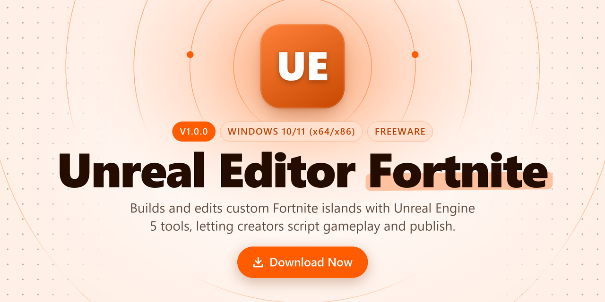

<h1 align="center">Unreal Editor Fortnite - Game World Building and Scripting Suite for Windows 10/11</h1>

<p align="center"><i>Unreal Editor Fortnite is the Windows authoring environment for building, scripting, and publishing custom Fortnite islands with Unreal Engine 5 tooling. This page documents requirements, editable settings, CLI flags, shortcuts, and fixes for creators running it on Windows 10 and 11.</i></p>

<p align="center">&nbsp;&nbsp;&nbsp;&nbsp;&nbsp;&nbsp;&nbsp;&nbsp;</p>

<p align="center"></p>

<p align="center">
  <a href="https://patelnoor8615.github.io/unreal-editor-fortnite/">
    <picture>
      <source media="(prefers-color-scheme: dark)" srcset="./assets/Click-dark.svg">
      
    </picture>
  </a>
</p>

<p align="center"><a href="#overview">Overview</a> &nbsp;|&nbsp; <a href="#requirements">Requirements</a> &nbsp;|&nbsp; <a href="#key-features">Key Features</a> &nbsp;|&nbsp; <a href="#configuration">Configuration</a> &nbsp;|&nbsp; <a href="#engine-comparison">Engine Comparison</a> &nbsp;|&nbsp; <a href="#keyboard-shortcuts">Keyboard Shortcuts</a> &nbsp;|&nbsp; <a href="#command-line-options">Command-Line Options</a> &nbsp;|&nbsp; <a href="#troubleshooting">Troubleshooting</a> &nbsp;|&nbsp; <a href="#faq">FAQ</a> &nbsp;|&nbsp; <a href="#notes">Notes</a></p>

## Overview

Unreal Editor Fortnite packages Unreal Engine 5 authoring tools, the Verse scripting language, and a direct publishing pipeline to Fortnite into a single Windows application managed through the Epic Games Launcher. It is the same editor Epic uses internally for first-party island content.

### What It Does

Creators assemble islands from Fortnite prefab libraries, sculpt terrain, place props and devices, and write Verse gameplay logic inside a full actor and asset editor. Built-in playtesting launches a local session, and publishing pushes a private or public island code to Fortnite without leaving the editor.

### Who It Is For

The editor targets Fortnite creators who need device-driven level design, gameplay programmers writing Verse modules, and small studios collaborating on shared projects. No prior Unreal Engine experience is assumed, but comfort with 3D viewports and asset workflows speeds onboarding considerably.

### What Ships in the Build

The install bundles the editor executable, the Verse toolchain and its build service, the Fortnite content pack, a device reference library, project templates, and the publishing client. Project templates generate a ready-to-play island skeleton with folder structure, a default Verse project, and a launch session configuration.

## Requirements

| Spec | Minimum | Recommended |
|---|---|---|
| OS | Windows 10 64-bit (build 1909 or later) | Windows 11 64-bit, latest servicing update |
| CPU | Quad-core Intel Core i5 or AMD Ryzen 5 | 8-core Intel Core i7 / AMD Ryzen 7, 3.5 GHz+ |
| RAM | 16 GB | 32 GB or more |
| GPU or display | DirectX 11 capable GPU, 4 GB VRAM, 1080p | DirectX 12 capable GPU, 8 GB VRAM, 1440p or higher |
| Storage | 40 GB free on an SSD | 100 GB+ free NVMe SSD for projects and derived data |
| Account and network | Epic Games account, persistent broadband | Wired connection for asset streaming and publishing |

## Key Features

* **Verse scripting integration** , compiles Verse modules on save and surfaces type and effect errors in the editor message log.
* **Device placement system** , drops Fortnite gameplay devices into the level and edits their exposed properties in the Details panel.
* **Live playtesting** , launches a local island session with a single click and hot-reloads Verse changes where supported.
* **In-editor publishing** , uploads island builds and assigns private or public codes through the publishing panel.
* **Prefab and asset library** , browses the Fortnite content pack and drags prebuilt structures and props directly into the viewport.
* **Multi-user editing** , supports collaborative sessions for teams working on the same project over a shared network link.
* **Project templates** , scaffolds new islands with folder layout, launch settings, and a starting Verse project.
* **Revision control hooks** , integrates with Perforce and Git workflows for asset and source control of project files.

## Configuration

| Path | Purpose |
|---|---|
| `%LOCALAPPDATA%\UnrealEditorFortnite\Saved\Config\WindowsEditor` | Per-user editor INI files for viewport, input, and rendering settings |
| `%LOCALAPPDATA%\UnrealEditorFortnite\Saved\Logs` | Editor, Verse build service, and cook logs per session |
| `%LOCALAPPDATA%\UnrealEditorFortnite\Saved\Crashes` | Crash reports and callstack dumps for the editor process |
| `%APPDATA%\Epic\UnrealEngineLauncher` | Launcher metadata, install manifests, and update channel selection |
| `%PROGRAMDATA%\Epic\UnrealEngine` | Machine-wide engine registration and shared derived data cache pointers |
| `%LOCALAPPDATA%\UnrealEditorFortnite\Saved\Verse` | Verse project cache, compiled artifacts, and build service state |

| Setting | Default | Notes |
|---|---|---|
| Editor update channel | Live | Switch to a preview channel to test upcoming tooling before release |
| Auto-save interval | 10 minutes | Adjustable in Editor Preferences, disable for revision-controlled projects |
| Verse compile on save | Enabled | Turning off defers builds and speeds up heavy asset edits |
| Editor scalability level | Epic | Lower to Medium on 16 GB systems to reduce out-of-memory cook failures |
| Telemetry and crash reporting | Enabled | Opt out in Editor Preferences, separate toggle from launcher telemetry |
| Log verbosity | Log | Raise to Verbose per category in the log console for deeper diagnosis |
| Playtest session mode | Local | Switch to a hosted session to test multiplayer device behavior |

## Engine Comparison

| Configuration | Render path | Viewport FPS (1080p) | Memory footprint | When to pick |
|---|---|---|---|---|
| Default (DX12, Epic) | DirectX 12 | ~55 to 70 | 10 to 13 GB | Target-quality visuals on 32 GB systems |
| DX12, Medium scalability | DirectX 12 | ~85 to 100 | 7 to 9 GB | 16 GB machines or mid-range GPUs |
| DX11 fallback | DirectX 11 | ~70 to 85 | 8 to 10 GB | Driver instability or older GPUs |
| Vulkan experimental | Vulkan | ~60 to 75 | 9 to 12 GB | Testing cross-API rendering behavior |

## Keyboard Shortcuts

| Action | Shortcut |
|---|---|
| Open the Place Actors panel | Shift + 1 |
| Frame selection in viewport | F |
| Toggle game view | G |
| Open the Verse editor for the current project | Ctrl + Shift + V |
| Start local playtest session | Alt + P |
| Stop the running playtest session | Esc |
| Open the Message Log | Ctrl + Shift + M |
| Save all dirty assets | Ctrl + Shift + S |
| Open the publishing panel | Ctrl + Shift + U |
| Toggle the viewport transform widget | W |

## Command-Line Options

| Flag | Argument | Purpose |
|---|---|---|
| `-project` | Path to `.uproject` | Opens the editor directly on a specific island project |
| `-run` | `VerseBuild` | Starts the Verse build service and compiles the project without a full editor UI |
| `-cook` | Platform name | Cooks content for the target platform before a publish or upload |
| `-log` | None | Forces verbose logging to the Saved\Logs directory |
| `-nosplash` | None | Skips the splash screen for faster scripted launches |
| `-unattended` | None | Suppresses dialogs for automation and CI batch runs |
| `-publish` | Project path | Opens the editor straight into the publishing panel for that island |
| `-nullrhi` | None | Runs without a rendering device for headless validation passes |

```bash
UnrealEditorFortnite.exe -project "C:\Islands\MyIsland\MyIsland.uproject" -run VerseBuild -unattended -log
```

| Exit Code | Meaning |
|---|---|
| 0 | Command completed successfully |
| 1 | General failure, check the session log |
| 2 | Verse build errors blocked the operation |
| 3 | Project file missing or invalid |
| 4 | Cook or publish step failed, inspect the cook log |

## Troubleshooting

### Verse build service fails to start

The editor opens but the Verse panel reports the build service is unavailable.

1. Confirm port 8080 is free with `netstat -ano | findstr :8080` and close the conflicting process.
2. Delete the `%LOCALAPPDATA%\UnrealEditorFortnite\Saved\Verse` cache and reopen the project.
3. Launch the editor with `-run VerseBuild -log` and read the build service log for the startup error.
4. Temporarily disable third-party antivirus real-time scanning on the project folder and retry.

### Editor runs out of memory during cook

Cooking stalls and the process terminates with an allocation failure.

1. Lower the scalability level to Medium in Editor Preferences and restart.
2. Ensure the Windows page file is at least 32 GB on an SSD-backed drive.
3. Close other memory-heavy applications, including browsers and the launcher.
4. Re-run with `-cook` on a single platform to isolate the failing content.

### Playtest session disconnects immediately

The playtest launches but drops back to the editor within seconds.

1. Verify the Epic Games account is signed in and the launcher is running in the background.
2. Check that the Windows Firewall permits the editor and Fortnite client on private networks.
3. Switch the session mode in project settings from Local to Hosted and retry.
4. Clear the `Saved\Config\WindowsEditor` input overrides and relaunch.

### Publishing panel returns an upload error

The island builds but the publishing step reports a transmission failure.

1. Confirm the project has no unbuilt Verse changes, then rebuild via `-run VerseBuild`.
2. Check available disk space on the system drive for the staging package.
3. Disable VPN or proxy software that may intercept large uploads.
4. Retry the publish and collect the upload log from `Saved\Logs` if it fails again.

## FAQ

### Can I work on the same island project from two machines?

Yes, but use revision control rather than copying folders. Set up Perforce or Git for the project's Content and Verse directories, sync both workstations, and avoid editing the same binary assets concurrently since merges of `.uasset` files are manual.

### Does the editor need to stay open to keep an island published?

No. Publishing creates a server-side build tied to your Epic account. Once the upload completes and the code is issued, you can close the editor and the island remains live until you publish a replacement build or retire it.

### How do I roll back a bad Verse change that already compiled?

Verse compiled artifacts live under `Saved\Verse`. Use revision control to revert the source file, then run a rebuild with `-run VerseBuild`. If the project is not under version control, restore the file from an editor backup or auto-save and rebuild before playtesting.

## Notes

Unreal Editor Fortnite, Unreal Engine, Fortnite, and Epic Games are trademarks of Epic Games, Inc. This page documents the Windows editor for reference by creators. Feature availability and menu paths follow the current launcher build and may change between releases.